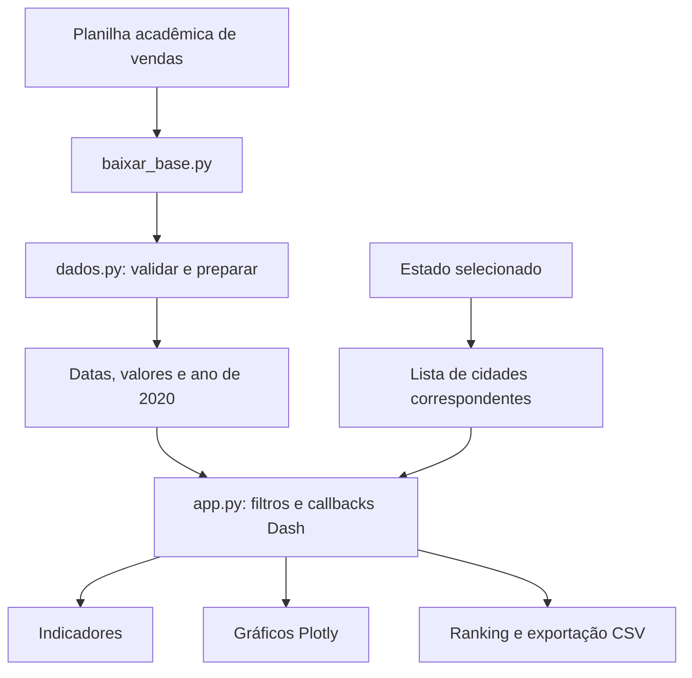

# Dashboard de Vendas 2020 — Guia de demonstração

Este documento apresenta um roteiro de navegação e um resumo da arquitetura do painel. Os dados são provenientes de uma planilha de atividade acadêmica e correspondem ao **ano de 2020**; o painel não consulta vendas em tempo real.

**Aplicação:** https://dashboard-vendas-2020.onrender.com/

## Roteiro prático

1. **Visão geral:** confira faturamento, número de registros, média por registro e quantidade de estados.
2. **Escolha uma dimensão:** filtre por mês, representante, regional, produto ou cliente.
3. **Compare os resultados:** observe a atualização conjunta dos indicadores e gráficos.
4. **Estado → Cidade:** selecione um estado; o filtro de cidades passa a oferecer apenas as cidades relacionadas.
5. **Ranking e exportação:** compare produtos e exporte a amostra filtrada. A exportação depende dos filtros ativos.
6. **Limpar filtros:** retorne à visão consolidada para recomeçar a análise.

Os valores variam com os filtros. Não utilizar capturas ou indicadores como métricas de negócios atuais.

## Caminho dos dados

O `dados.py` padroniza colunas, converte valores e datas, descarta registros inválidos e restringe a análise a 2020. `app.py` define interface, callbacks e visualizações. `assets/styles.css` define responsividade e estilos.

## Como interpretar os indicadores

| Indicador | Significado |
| --- | --- |
| Faturamento total | Soma de `Valor_Total_Venda` após filtros |
| Vendas registradas | Quantidade de linhas de vendas após filtros |
| Média por registro | Soma das vendas ÷ quantidade de registros |
| Estados atendidos | Contagem de estados distintos nos registros filtrados |

O gráfico mensal agrega os valores de vendas por mês. O ranking de produtos apresenta faturamento e participação percentual em relação aos registros filtrados.

## Exemplo de exploração (sem números inventados)

**Pergunta:** quais produtos representam maior faturamento na regional selecionada?

1. Escolha uma regional no filtro.
2. Observe o ranking de produtos.
3. Selecione um representante para restringir a análise.
4. Compare o ranking e os indicadores antes/depois do filtro.
5. Exporte os dados filtrados se precisar conferir a soma em uma planilha.

**Pergunta:** quais cidades apresentam mais vendas dentro de um estado?

1. Escolha um estado no filtro geográfico.
2. Use o detalhamento por cidade.
3. Selecione as cidades desejadas e compare os indicadores.

## Qualidade e limitações

- `testes_auditoria.py` utiliza uma base **sintética**, independente da planilha real, para verificar funções de limpeza, agregação e filtros.
- A planilha vem de repositório externo; falha na origem pode afetar builds futuros.
- O Render gratuito pode suspender serviços após inatividade, aumentando o tempo da primeira visita.
- A precisão do painel depende da qualidade da fonte original. Nenhuma métrica financeira foi validada como resultado de operação comercial real.

## Checklist de demonstração

- [ ] Aplicação responde após eventual inicialização.
- [ ] Os indicadores e gráficos aparecem.
- [ ] O filtro Estado → Cidade altera as opções corretamente.
- [ ] Botão limpar retorna à visão inicial.
- [ ] Exportação respeita os filtros atuais.
- [ ] A fonte e o caráter acadêmico dos dados são explicados.

Repositório: https://github.com/Dhaniels1/dashboard-vendas-2020
